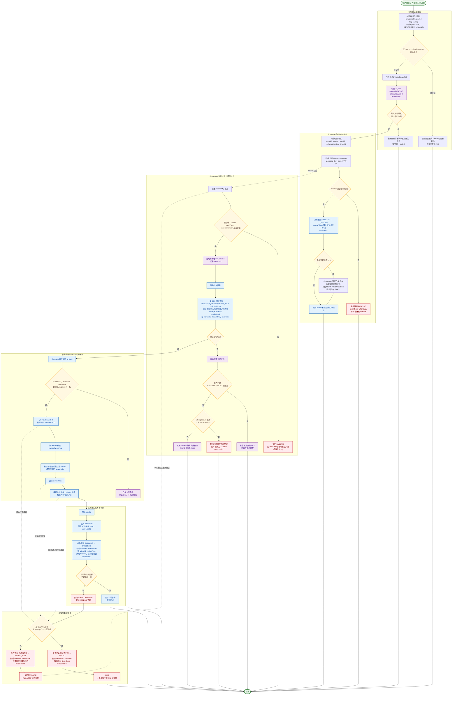
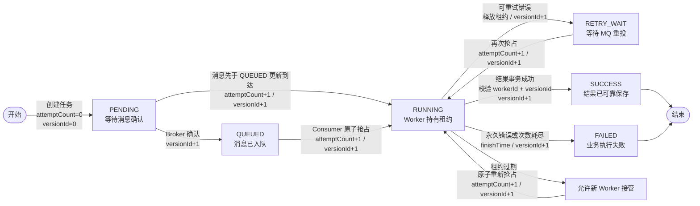

# AI 应用 RocketMQ——版本 1

> 版本定位：从同步 Qwen Plus 营养分析改造成可查询、可重试、可恢复的 RocketMQ 异步任务。
>
> 本文已经合并原《diary-AI 接入 RocketMQ 异步改造方案》和《RocketMQ 中消息与消费关系》的核心内容。

## 1. 改造起点

最初的 AI 营养分析是同步流程：

```text
POST /ai/invoke
  → 参数校验
  → 选择 InvokeQwenPlus
  → 调用 Qwen Plus
  → 解析模型结果
  → 写入数据库
  → 返回处理结果
```

该链路存在请求线程长期占用、客户端超时后无法确认执行状态、服务重启后难以恢复、重复提交可能产生重复费用等问题。

版本 1 将其改造成异步任务：

```text
客户端提交请求
  → diary-AI 校验请求并生成 taskId
  → 保存 ai_task 和稳定 inputSnapshot
  → Producer 发送 RocketMQ 任务消息
  → HTTP 返回 taskId
  → Consumer 抢占任务并调用 Qwen Plus
  → 保存结果并更新任务状态
  → 发布完成或失败事件
```

本期只迁移 `InvokeQwenPlus` 营养分析链路，不一次性迁移全部模型，也不把 Worker 拆成新的独立服务。

## 2. 第一版范围和消息规划

第一版使用 RocketMQ 5.x Normal Message，重点建立：

- 任务 Topic、Tag、Message Key 和 Consumer Group。
- `ai_task` 任务状态机。
- 稳定输入快照。
- Consumer 原子抢占和消费幂等。
- 有限消费重试和死信处理。
- AI 完成、失败事件。
- 消息积压、消费耗时和模型异常观察。

第一版不依赖 FIFO 或 Delay Message。任务消息使用 taskId 作为 Message Key，消息协议携带 `eventId`、`taskId`、`userId`、`taskType`、`schemaVersion`、`occurTime` 和 `traceId`。消息只携带任务定位信息，完整输入从数据库快照读取。

## 3. 第一版完整流程

下图覆盖任务提交幂等、RocketMQ 投递、Consumer 原子抢占、任务执行、结果事务、失败重试、`attemptCount`、`versionId` 和租约控制。



## 4. 核心字段变化



## 5. 字段语义

- `attemptCount`：只在 Consumer 成功抢占、准备进入一次模型执行流程时由数据库递增；MQ 重复投递、协议解析失败和抢占失败均不递增。
- `versionId`：创建时为 `0`，每次有效状态迁移都由数据库执行 `version_id = version_id + 1`。
- `workerId + versionId`：共同证明当前线程仍拥有 RUNNING 任务；旧 Worker 失去租约后不能再提交 SUCCESS、FAILED 或 RETRY_WAIT。
- `leaseUntil`：Consumer 抢占时写入；离开 RUNNING 状态时清空，租约过期后允许其他 Worker 接管。
- `finishTime`：只在 SUCCESS 或 FAILED 终态写入，PENDING、QUEUED、RUNNING、RETRY_WAIT 均保持为空。

## 6. 一条消息与多个 Consumer 的关系

同一个 Consumer Group 内部署多个实例时，一条消息在一次正常投递中只会分配给其中一个 Consumer；不同 Consumer Group 会各自收到一份消息。

“正常情况下只分配给一个 Consumer”不等于消息永远只会处理一次。以下情况都可能引起重复投递：

- Consumer 返回失败。
- Consumer 超时或在 ACK 前宕机。
- Broker 没有收到成功确认。
- 业务已经完成，但确认链路发生异常。

因此 Consumer 必须按至少一次投递设计，不能依赖内存标记判断消息是否处理过。

## 7. 数据库抢占、租约和版本号

Consumer 收到消息后，不直接调用模型，而是先执行条件更新：

```text
PENDING/QUEUED/RETRY_WAIT → RUNNING
  + workerId
  + leaseUntil
  + attemptCount + 1
  + versionId + 1
```

只有成功更新一行的 Consumer 获得执行权。抢占失败时：

- 任务已是终态：说明是重复消息，直接 ACK。
- 任务仍被其他 Worker 有效持有：当前 Consumer 不执行模型。
- 租约过期且仍允许重试：后续 Worker 可以重新抢占。

租约过期不会自动停止旧 Consumer，因此结果提交还必须校验 `workerId + versionId`。新的 Worker 接管后会持有新的版本号，旧 Worker 即使晚返回也无法覆盖新结果。

## 8. 重试和失败分类

可重试错误包括临时网络错误、服务端限流和短暂不可用；请求参数错误、无法修复的输入和确定性的业务错误属于不可重试错误。

重试分为不同层次：

- RocketMQ 重投处理消息交付失败。
- `attemptCount/maxAttempts` 限制实际模型执行次数。
- 任务租约处理 Worker 宕机或长时间卡死。

不能使用无限重试，也不能用失败重试代替限流。每次模型调用都有费用，重试次数必须有明确上限。

## 9. 第一版的边界

第一版已经把同步调用改造成异步任务，但任务落库和 Producer 发送仍是两个独立动作，存在数据库成功而消息发送失败、Broker 成功而数据库状态未更新等双写窗口。

因此版本 2 引入 Outbox，把“创建任务”和“创建待发送消息”放入同一个 MySQL 本地事务，并继续完善任务状态、失败事件和故障恢复。
