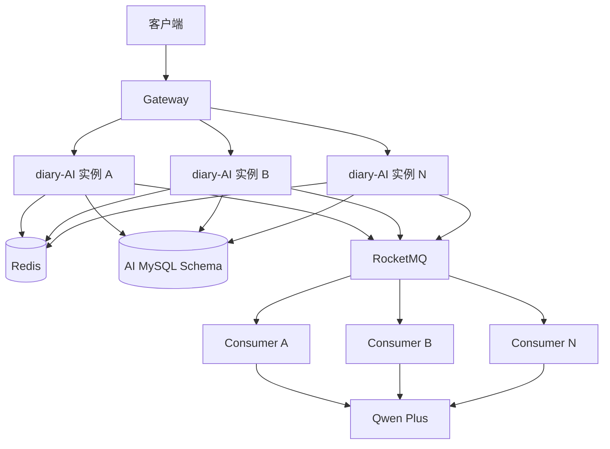

# AI 应用 RocketMQ 分布式演进说明书——版本 3

> 适用模块：`diary-AI`
>
> 文档定位：说明 `diary-AI` 如何从同步基础应用逐步演进为可靠异步服务，并进一步走向多实例分布式服务。
>
> 当前代码基线：版本 2 的单实例可靠任务闭环。
>
> 版本 3 定位：多实例分布式目标和后续实施顺序，不代表本文中的所有能力均已落地。

## 1. 阅读说明

这份说明书关注的不是单个类或某段代码，而是 `diary-AI` 在不同阶段面对的问题、引入的机制，以及这些机制之间的责任边界。

整体分布式边界以 [`分布式 Diary 的说明书`](../../docs/分布式Diary的说明书.md) 为依据，本文将其中的数据所有权、公共模块拆分、网络治理、容器化、可观测性、测试和配置治理要求落实到 AI 模块。

三份文档按发展顺序阅读：

1. `AI应用RocketMq-版本1.md`：从同步调用到直接投递 RocketMQ 的第一版任务闭环，同时包含消息、消费、抢占和租约原理。
2. `AI应用RocketMq-版本2-实操手册.md`：Outbox、幂等、状态机、租约、恢复、接口、排障和测试组成的单实例可靠版本。
3. 本文：从当前单实例基线继续演进到多实例分布式服务。

整个过程可以概括为：

```text
同步基础应用
  → RocketMQ 异步任务
  → 数据库任务状态机
  → Outbox 可靠投递
  → 幂等、重试、租约和故障恢复
  → 单实例可靠服务
  → 数据与服务边界解耦
  → 多实例协调和集群级流量治理
  → 可独立部署、扩容、故障和恢复的分布式 AI 服务
```

## 2. 阶段 0：同步基础应用

最初的 AI 营养分析是一条同步调用链：

```text
POST /ai/invoke
  → 参数校验
  → 选择 InvokeQwenPlus
  → 调用 Qwen Plus
  → 解析模型结果
  → 写入数据库
  → 返回处理结果
```

这个阶段能够完成业务，但 HTTP 请求必须一直等待模型返回。大模型调用耗时较长，还可能因为网络、限流或响应格式异常而失败，因此存在以下问题：

- 请求线程长时间占用。
- 客户端超时后无法确定任务是否仍在执行。
- 服务重启后无法恢复执行中的请求。
- 没有统一的排队、重试和失败状态。
- 客户端无法查询任务进度。
- 同一个请求重复提交可能产生重复模型费用和重复结果。

因此，第一步不是增加更多微服务，而是把长耗时 AI 调用改造成可查询、可恢复的异步任务。

## 3. 阶段 1：RocketMQ 异步化

第一版引入 `ai_task` 和 RocketMQ，把 HTTP 受理与模型执行分离：

```text
客户端提交任务
  → diary-AI 校验请求并生成 taskId
  → 保存任务和输入快照
  → Producer 发送 RocketMQ 消息
  → HTTP 返回 taskId

RocketMQ Consumer
  → 抢占 ai_task
  → 读取输入快照
  → 调用 Qwen Plus
  → 保存结果
  → 更新任务状态
```

### 3.1 这一阶段解决的问题

- HTTP 不再同步等待模型执行。
- 客户端可以通过 taskId 查询状态和结果。
- RocketMQ 可以在消费失败时重新投递消息。
- 数据库保存任务状态，服务重启后任务不会完全丢失。
- `workerId + versionId`、条件更新和任务状态可以阻止大多数重复执行。

### 3.2 第一版的核心状态

```text
PENDING → QUEUED → RUNNING → SUCCESS
                         └→ RETRY_WAIT
                         └→ FAILED
```

Consumer 通过一条条件 SQL 把 `PENDING/QUEUED/RETRY_WAIT` 原子更新为 `RUNNING`，同时写入 `workerId`、`leaseUntil`，增加 `attemptCount` 和 `versionId`。

重复消息到达时，如果任务已经是终态，Consumer 直接 ACK，不再次调用模型；如果任务正被其他 Worker 持有，则不覆盖对方的执行权。

### 3.3 第一版仍然存在的问题

第一版在创建任务后直接发送 RocketMQ，数据库提交和 Broker 发送属于两个独立动作：

```text
数据库任务创建成功
  +
RocketMQ 消息发送成功
```

两者之间没有一个共同事务，因此可能出现：

- 任务已经落库，但消息没有发送成功。
- 消息已经被 Broker 接收，但服务没有成功更新数据库状态。
- 服务在两个动作之间宕机，留下无法判断的中间状态。

RocketMQ 的“至少一次”投递还意味着消息可能重复，不能把“只消费一次”作为系统正确性的前提。

## 4. 阶段 2：Outbox 单实例可靠闭环

版本 2 不再在 HTTP 提交链路直接发送消息，而是在同一个 MySQL 本地事务中写入任务和 Outbox：

```text
HTTP 提交
  → 校验身份、参数和幂等键
  → 本地事务：ai_task=PENDING + mq_outbox=NEW
  → 提交事务
  → 返回 202 + taskId

AiOutboxPublisher
  → 扫描 NEW/RETRY_WAIT
  → 领取 Outbox
  → 发送 RocketMQ
  → 确认成功后标记 SENT
```

这样，“任务存在但没有待发送消息”的双写问题被收敛到数据库本地事务中。

### 4.1 版本 2 的职责边界

| 故障阶段 | 主要机制 |
| --- | --- |
| 任务落库与消息创建 | MySQL 本地事务 + Outbox |
| Outbox 到 Broker | Publisher 有界退避重试 |
| Broker 到 Consumer | RocketMQ 消费重投和 DLQ |
| 重复提交 | MySQL 唯一索引 + `request_hash` |
| 重复消费 | 任务状态机 + 条件更新 |
| 模型执行失败 | `attempt_count/max_attempts` |
| Worker 崩溃或模型卡死 | RUNNING 租约 + Recovery Job |
| 请求过载 | Redis 用户提交限流 + 本地 Semaphore |

### 4.2 两套状态不能混为一体

`ai_task.status` 表示 AI 任务的业务执行事实：

| 状态 | 含义 |
| --- | --- |
| `PENDING` | 任务和初始 Outbox 已提交，尚未确认 Broker 接收 |
| `QUEUED` | 任务消息已经得到 Broker 成功回执 |
| `RUNNING` | Consumer 已获得任务执行权 |
| `RETRY_WAIT` | 本次执行失败，等待重新投递或恢复 |
| `SUCCESS` | 结果和成功状态已经提交 |
| `FAILED` | 永久错误或执行次数耗尽 |
| `DEAD_LETTER` | 任务投递耗尽，任务没有正常开始执行 |
| `CANCELLED` | 预留终态，当前没有取消链路 |

`mq_outbox.status` 表示事件的投递事实：

| 状态 | 含义 |
| --- | --- |
| `NEW` | 本地事务已创建，等待发送 |
| `SENDING` | Publisher 已领取，等待发送结果 |
| `RETRY_WAIT` | 上次发送失败，等待退避重试 |
| `SENT` | Broker 已确认收到消息 |
| `DEAD` | 发送重试耗尽，等待排障或人工处理 |

`Outbox=SENT` 只表示 Broker 收到消息，不表示 Consumer 已经执行完成；`task=SUCCESS` 也不表示完成事件已经被下游消费。

### 4.3 提交幂等

提交幂等以 MySQL 为最终依据：

```text
UNIQUE(user_id, client_request_id)
  + request_hash
  + 唯一键冲突后重读
```

- 相同用户、相同幂等键、相同请求内容：返回原任务。
- 相同用户、相同幂等键、不同请求内容：返回幂等冲突。
- Redis 不承担提交幂等的最终事实。

### 4.4 输入快照

任务创建时保存稳定的 `inputSnapshot`。Consumer 从任务记录读取快照，不依赖最初的 HTTP 请求上下文。

快照还能避免异步执行期间跨服务数据发生变化。例如任务分析的是某个 Recipe，任务创建时应保存分析所需的菜谱名称、食材、用量和烹饪方式。即使 Recipe 后来被修改，任务仍按提交时的数据执行。

### 4.5 Worker 所有权和租约

Consumer 抢占任务时生成 `workerId`，并记录：

```text
worker_id
lease_until
version_id
attempt_count
```

结果提交必须匹配 `taskId + workerId + versionId`。旧 Worker 即使在租约过期后恢复，也不能覆盖新 Worker 已经提交的结果。

模型执行期间按照租约周期续期；续期同样必须匹配 Worker 所有权。Recovery Job 只恢复租约已经过期的 `RUNNING` 任务。

### 4.6 成功和失败事务

成功时，在同一个本地事务中完成：

```text
写入 AI 调用记录
  + 写入营养结果
  + RUNNING → SUCCESS
  + 创建 AI_COMPLETED Outbox
```

失败时，永久错误或执行次数耗尽需要在同一事务中完成：

```text
RUNNING → FAILED
  + 创建 AI_FAILED Outbox
```

状态更新必须恰好影响一行。任一步失败都应抛出异常，使整个事务回滚，不能在事务内部吞掉异常后提交部分结果。

## 5. 阶段 2 的修复和简化过程

版本 2 在形成最终边界前经历了多次状态和 Outbox 修复。

### 5.1 Task 与 Outbox 终态一致性

改造前，部分失败路径只把任务更新为 `FAILED`，没有创建 `AI_FAILED` Outbox；任务投递 Outbox 进入 `DEAD` 后，任务也可能永久停留在等待态。

改造后：

- 执行次数耗尽统一提交 `FAILED + AI_FAILED Outbox`。
- 任务投递重试耗尽时，只把仍处于等待态的任务更新为 `DEAD_LETTER`，同时追加失败事件。
- 已经 `RUNNING/SUCCESS/FAILED` 的任务不会被旧 Outbox 覆盖。

### 5.2 失败事件协议统一

完成和失败事件统一使用 `AiTaskEventDto`。Outbox 的 `event_id` 与消息 payload 中的 `eventId` 保持一致，成功和失败分别使用 `AI_COMPLETED` 与 `AI_FAILED` Tag。

### 5.3 租约续期和崩溃恢复

租约不再只在抢占时写入一次。模型执行期间定期续租，进程崩溃后由 Recovery Job 将过期的 `RUNNING` 任务迁移到 `RETRY_WAIT`，并在同一事务中创建 `AI_TASK_RETRY` Outbox。

### 5.4 用户归属

用户身份不再固定为 `10000`：

```text
JWT user_id
  → Gateway 删除客户端伪造身份头
  → 写入 X-Auth-User-Id
  → AI 使用 taskId + userId 查询
```

这样可以防止用户通过猜测 taskId 查询其他用户的 AI 任务。

### 5.5 删除重复保障

简化后的当前基线不缓存任务状态，也不使用 Redis 幂等映射。Redis 只负责每用户提交限流，MySQL 是任务状态和幂等事实的唯一权威。

当前版本也不扫描普通 `PENDING/QUEUED/RETRY_WAIT` 自动生成多代恢复消息，而是把责任明确分给 Outbox 重试、RocketMQ 重投和 RUNNING 租约恢复。

## 6. 当前基线：可靠但仍是单实例服务

当前版本已经具备：

- HTTP 异步受理和任务查询接口。
- `ai_task + mq_outbox` 同事务创建。
- Outbox 领取、发送、退避重试和超时恢复。
- RocketMQ 至少一次投递下的消费幂等。
- MySQL 提交幂等和请求指纹。
- Consumer 原子抢占、执行次数和任务租约。
- `workerId + versionId` 所有权校验。
- 成功、失败和恢复事务。
- Redis 每用户提交限流。
- 本地 Semaphore 模型并发限制。
- `InvokeAIService + AIFactory` 模型扩展入口。

但是当前设计边界仍然是单个 `diary-AI` 应用实例：

- 本地 Semaphore 只能限制一个 JVM。
- 定时 Publisher 和 Recovery Job 没有完整的集群级协调。
- 当前提交限流还没有形成完整的集群级令牌桶治理。
- 多个实例竞争 Outbox 时仍需要验证批量领取效率和公平性。
- 服务边界、数据库边界、部署、观测和自动化测试还没有全部闭环。

因此，接下来不是推倒版本 2，而是在其数据库状态机、Outbox 和条件更新基础上增加多实例能力。

## 7. 阶段 3：服务和数据边界解耦

多实例部署之前，需要先明确 `diary-AI` 的数据所有权。

### 7.1 AI 服务拥有的数据

AI 服务应独立拥有并维护：

```text
ai_task
ai_info
ai_nutrient
mq_outbox 中属于 AI 的记录
```

AI 服务使用自己的 Schema 和数据库账号，只访问自己的数据库。其他服务不能直接更新 AI 表，AI 也不应直接 JOIN Recipe 等其他服务的表。

### 7.2 Recipe 数据的获取方式

AI 获取 Recipe 数据可以根据场景选择：

1. 必须得到最新数据时，通过 Recipe 服务的网络接口查询。
2. 读多且允许短暂延迟时，通过 Recipe 事件维护本地只读数据。
3. AI 异步执行时，优先在任务创建阶段保存稳定输入快照。

如果列表需要展示多个 Recipe 信息，应使用批量接口或本地读模型，不能对每条记录单独发送一次请求形成 N+1 调用。

### 7.3 `diary-common` 的拆分

AI 的 PO、Mapper 模型、业务 DTO、VO、业务枚举和只由 AI 使用的工具应迁回 `diary-AI`，由 AI 服务独立维护。

HTTP 或 MQ 消息契约可以放入小型、版本化的 Contract 模块，但数据库 PO 不能成为跨服务公共契约。

## 8. 阶段 3：多实例总体架构

目标运行形态如下：



多实例带来的问题包括：

- 多个实例同时扫描和领取 Outbox。
- 多个实例同时运行 Recovery Job。
- 多个 Consumer 共同占用 Qwen Plus 配额。
- 所有实例需要共享用户提交额度。
- Worker 宕机、扩缩容和旧 Worker 延迟回写。
- 消息被重复投递或被多个下游实例处理。

第三版继续坚持以下原则：

1. MySQL 是任务、Outbox 和结果的最终事实源。
2. RocketMQ 按至少一次投递设计，重复消息是正常情况。
3. Redis 用于协调和流量治理，不能代替数据库状态机与唯一约束。
4. 分布式锁只保护适合串行执行的短任务，不能包围整个模型调用。
5. 所有可能过期的所有权必须使用 fencing token、`workerId + versionId` 或条件 SQL 防止旧持有者回写。
6. 扩容不能突破 Qwen Plus 的集群配额和费用上限。

## 9. 多实例 Outbox 协调

不能给整个 Publisher 加一把全局分布式锁，否则多个实例最终仍然只有一个实例发送消息，扩容没有意义。

### 9.1 当前乐观锁方案

多个实例可以先查询候选 Outbox，再通过以下条件竞争领取：

```text
WHERE id = ?
  AND status IN ('NEW', 'RETRY_WAIT')
  AND version_id = ?
```

只有更新成功的实例才能发送消息。该方案可以作为多实例初期的兼容方式。

### 9.2 批量领取目标

数据量增长后，可以使用 MySQL 8 的 `FOR UPDATE SKIP LOCKED` 批量领取不同 Outbox，减少多个实例反复读取同一批候选记录。

无论采用哪种方式，都要保留：

- `SENDING` 超时恢复。
- 有界退避重试。
- `version_id` 条件确认。
- `event_id` 唯一约束。
- Consumer 幂等。

因为 Broker 成功而数据库确认失败时仍可能重复发送，所以 Outbox 无法把系统变成“恰好一次”，最终仍依赖消费端幂等。

## 10. 分布式调度和恢复

Publisher、Recovery 和清理任务在每个实例中都会被 Spring Scheduling 触发。

可以对清理类、扫描类短任务使用 Redisson 分布式锁或任务分片，避免所有实例重复做同一批扫描。但锁不是最终正确性的保证，数据库条件更新仍然必须存在。

正确边界是：

```text
分布式锁或分片 → 减少重复扫描
条件 SQL/CAS    → 保证最终状态正确
```

锁不能覆盖整个模型调用。模型调用时间较长，锁续期、实例崩溃和网络分区会使长时间持锁变得危险。

## 11. 集群级流量和费用治理

### 11.1 分布式提交限流

所有 AI 实例共享用户提交额度。固定窗口可以作为当前基础，第三版目标是使用 Redis 原子脚本实现令牌桶或等价的原子限流逻辑，并明确 Redis 故障时采用 fail-open 还是 fail-close。

Redis Cluster 环境中的相关 Key 需要使用一致的 Hash Tag，确保 Lua 脚本涉及的 Key 位于同一个 Slot。

### 11.2 全局模型并发许可

本地 Semaphore 只能限制单个 JVM：

```text
3 个实例 × 每实例并发 2 = 集群并发 6
```

如果 Qwen Plus 的安全并发上限是 2，就需要集群级并发许可。版本 3 使用带租约的 Redis ZSet 信号量作为目标：

```text
获取许可
  → 清理过期许可
  → 判断当前许可数量
  → 写入 ownerId 和过期时间
  → 执行模型调用
  → 定期续期
  → finally 释放
```

数据库任务租约和模型并发许可解决的是两个不同问题：

- 数据库租约保护任务执行权。
- Redis 全局许可保护供应商配额和费用上限。

## 12. 任务租约、版本号和 fencing

多实例环境中，租约过期不代表旧 Worker 会自动停止。旧 Worker 可能仍在等待模型响应，新 Worker 已经接管任务。

因此：

- 续租必须匹配 `taskId + workerId + versionId`。
- 成功或失败回写必须匹配同一组所有权字段。
- Recovery 只能接管租约已经过期的 `RUNNING`。
- 旧 Worker 失去所有权后不能提交结果。

`versionId` 在这里承担 fencing token 的作用，使新的所有权版本能够拒绝旧执行者的延迟写入。

## 13. 网络调用治理

AI 服务与 Recipe 服务、Qwen Plus 等外部依赖通过网络通信后，需要统一处理：

- 连接超时和读取超时。
- 熔断、限流和并发隔离。
- 降级策略。
- 有边界的重试。
- 幂等键和请求指纹。
- API 或消息协议版本。
- Trace ID 透传。

查询请求通常可以有限重试。创建、扣费或其他写操作不能盲目重试，必须先确认幂等边界。模型调用重试还必须受 `maxAttempts`、全局并发和费用上限共同控制。

## 14. 优雅停机和实例故障

实例正常退出时需要：

1. 停止接收新的 HTTP 请求和消息。
2. 停止领取新的 Outbox 和 AI 任务。
3. 等待正在执行的短任务完成。
4. 对长时间模型调用继续维护任务租约，或让其在停机后通过租约超时恢复。
5. 关闭 Consumer、线程池和数据库连接。

强制宕机后依靠现有机制恢复：

- `SENDING` Outbox 超时回到可重试状态。
- `RUNNING` 任务租约过期后由 Recovery 生成重试事件。
- Redis 全局许可到期后自动释放。
- 重复消息由任务状态和条件 SQL 拦截。

## 15. 独立部署和配置治理

`diary-AI` 作为真实运行服务，需要拥有自己的 Dockerfile。开发和测试环境可以通过 Docker Compose 启动：

```text
Nacos
AI MySQL Schema
Redis
RocketMQ
Gateway
diary-AI 单实例或多实例
Prometheus
Grafana
```

推荐顺序为：

```text
单服务 Docker
  → Docker Compose 完整环境
  → 两个 AI 实例验证竞争和恢复
  → CI/CD
  → 根据部署规模决定是否引入 Kubernetes
```

数据库密码、Nacos 地址和凭证、Redis/RocketMQ 凭证、JWT 密钥和模型 API Key 应通过环境变量或密钥管理系统提供。AI 服务使用只能访问 AI Schema 的最小权限数据库账号。

## 16. 可观测性

一次 AI 请求需要能够贯穿以下链路：

```text
Gateway
  → AI Controller
  → ai_task + Outbox
  → Outbox Publisher
  → RocketMQ
  → AI Consumer
  → Qwen Plus
  → 结果事务
  → AI_COMPLETED/AI_FAILED
```

HTTP 和 MQ 消息中都应传播 Trace ID，并在 Consumer 恢复日志上下文。日志至少关联：

```text
traceId
eventId
taskId
userId
workerId
instanceId
attemptCount
```

重点指标包括：

- HTTP 请求量、错误率和 P95/P99 延迟。
- AI 任务排队时间、执行时间、成功率和失败率。
- Qwen Plus 调用耗时、异常类型和集群并发数。
- Outbox 的 `NEW/SENDING/RETRY_WAIT/DEAD` 数量。
- RocketMQ 消息堆积、消费延迟和重投次数。
- 租约过期、Recovery 次数和旧 Worker 回写拒绝次数。
- JVM、线程池、数据库连接池和 Redis 延迟。

## 17. 测试体系

版本 3 需要在现有测试用例基础上覆盖：

1. 两个实例同时提交相同幂等键。
2. 两个 Publisher 同时领取同一 Outbox。
3. Broker 接收成功但 Outbox 确认失败。
4. 同一任务消息重复投递。
5. 两个 Consumer 同时抢占同一任务。
6. Worker 模型调用期间宕机。
7. 租约过期后新 Worker 接管，旧 Worker 延迟返回。
8. Redis 不可用时限流和并发许可的故障策略。
9. RocketMQ 暂时不可用和重试耗尽。
10. 多实例下全局并发不超过供应商限制。
11. AI、Recipe 或 Gateway 网络调用超时和降级。
12. 服务滚动停止期间任务不丢失、不重复落结果。

测试体系包括单元测试、MySQL/Redis/RocketMQ 集成测试、服务契约测试、完整链路 E2E 测试，以及故障注入和恢复测试。测试文档不能代替自动化测试。

## 18. 实施顺序

### 阶段 0：确认版本 2 基线

- 以 `AI应用RocketMq-版本2-实操手册.md` 中记录的单实例最终边界为当前代码基线。
- 验证任务和 Outbox 两套状态机。
- 完成单实例重复消息、发送失败、执行失败和租约恢复测试。

### 阶段 1：建立服务和数据边界

- 为 AI 数据建立独立 Schema 和最小权限账号。
- 删除 AI 对 Recipe 等其他服务表的直接 JOIN。
- 将 AI 领域模型从巨型 `diary-common` 迁回 AI 模块。
- 明确 Recipe API、事件或任务输入快照的使用边界。

### 阶段 2：容器化并部署两个实例

- 为 `diary-AI` 创建 Dockerfile。
- 使用 Docker Compose 启动完整依赖。
- 部署两个 AI 实例，观察 Outbox、Consumer 和 Recovery 的竞争行为。

### 阶段 3：优化 Outbox 多实例领取

- 先验证现有乐观锁领取。
- 数据量增长后再引入 `SKIP LOCKED` 批量领取。
- 验证 Broker 成功但数据库确认失败时的重复消息。

### 阶段 4：分布式调度协调

- 对扫描和清理类短任务使用分布式锁或分片。
- 保留数据库条件更新作为最终正确性保障。

### 阶段 5：集群级流量治理

- 将用户提交限流改为 Redis 原子限流。
- 引入带租约的全局模型并发许可。
- 明确 Redis 故障策略和费用保护边界。

### 阶段 6：完善租约和优雅停机

- 验证长时间模型调用续租。
- 验证旧 Worker 的延迟回写被 fencing 拒绝。
- 完成滚动停止和强制宕机恢复测试。

### 阶段 7：可观测性和自动化测试闭环

- 打通 Gateway、HTTP、Outbox、RocketMQ、Consumer 和模型调用的 Trace。
- 建立指标面板和告警。
- 自动化执行多实例、重复投递、超时和故障恢复测试。

## 19. 版本 3 验收标准

版本 3 完成时应满足：

- `diary-AI` 只访问自己的 Schema，不直接 JOIN 其他服务表。
- AI 业务模型由 AI 模块维护，跨服务只共享稳定契约。
- 两个及以上 AI 实例可以同时运行。
- 重复提交返回同一任务或明确的幂等冲突。
- 重复消息不会产生重复结果。
- 多个 Publisher 不会对同一 Outbox 产生无控制的并发发送。
- 多个 Consumer 不会同时提交同一任务结果。
- 旧 Worker 失去租约后不能覆盖新 Worker 的结果。
- 集群提交速率和模型并发不超过配置上限。
- 任一实例宕机后，Outbox 和 RUNNING 任务能够恢复。
- HTTP、MQ 和模型调用可以通过 Trace ID 串联。
- 服务能够通过 Docker Compose 重复部署，并完成多实例故障测试。
- 配置和密钥不写死在代码仓库，数据库账号遵循最小权限原则。

## 20. 演进结论

`diary-AI` 的分布式演进不是简单地加入 RocketMQ、Redis、Docker 或 Kubernetes，而是逐步明确每一种故障由谁负责：

```text
MySQL 状态机     → 业务事实和最终幂等
Outbox            → 数据库事务到消息发送之间的可靠衔接
RocketMQ          → 异步分发和至少一次投递
条件 SQL/版本号   → 多 Worker 竞争和旧 Worker 隔离
任务租约          → 进程崩溃和长时间执行恢复
Redis             → 集群级限流与并发治理
服务契约和快照    → 跨服务数据边界
容器与编排        → 独立部署、扩容和恢复
日志、指标和链路  → 分布式问题定位
自动化测试        → 验证重复、超时和部分失败
```

最终目标是让 `diary-AI` 从“一个同步调用大模型的业务模块”，发展为“拥有独立数据、通过明确契约协作，并能够独立部署、扩容、故障和恢复的分布式 AI 服务”。
